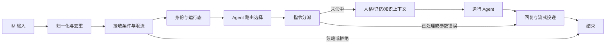

## Context

2026-10-25 用户要求将项目直接重构为 TypeScript，保留 Agent 概念；参考 AstrBotX 的并发、执行环境、图片/文件与流式、记忆、RAG、多 Agent 和 IM 适配；首期使用 OpenAI Agents SDK、后续可能扩展 Codex SDK；增加三个权限运行态；重构代码级指令；路由可视化；保持 Dashboard 视觉；禁止弱类型。

用户本轮进一步确认：没有具体 agentflow 产品；首版仅一套固定路由，节点参数可编辑，暂不自定义拓扑。运行态按当前发送者在当前会话中的有效权限解释，切换由服务端校验。这些约束优先于旧 Rust 设计中“图节点独立授予权限”和“自由图编辑器”的内容。

工作区已有 Kotlin/JNI 实现以及 `rewrite-rust-agent-runtime` 计划和前端接入改动。它们作为需求、行为和测试参考，不能直接计入 TypeScript 实现完成度。现有未提交工作保留，切换按独立入口、配置和数据目录推进。

用户已确定首期引擎采用官方 `@openai/agents`。官方概念和验证门禁见 [sdk-evidence.md](sdk-evidence.md)；先前 Codex SDK 0.164.0 发布包调查保留在 [codex-sdk-reference.md](codex-sdk-reference.md)，只用于未来扩展参考。首期运行模型循环在 TS 应用内，不依赖 Codex CLI；数据库和执行沙箱可以具有外部原生依赖。

## Goals / Non-Goals

**Goals**：强类型服务端与前端契约；保留独立 Agent；Agents SDK 首个引擎与独立引擎边界；三态权限；固定路由可视化与节点编辑；代码指令；文本/图片/文件与真实流式能力；隔离执行；长期记忆、知识库、主动委派；现有三种 IM 迁移并建立其他 IM 的扩展路径；保持现有视觉。

**Non-Goals**：本期音频/语音；自由增删节点、连线或多套自定义流程；用户脚本节点与动态指令作者 UI；兼容 JVM/Python 插件二进制；依赖私有 Codex fork；以框架骨架代表完成重构。Codex SDK/CLI、fork code mode 和跨引擎原生状态迁移不在首期实现范围。首期运行中追加使用有界下一轮队列；其他控制语义在所选 Agents SDK 版本验证后按能力声明扩展。

## Decisions

### 1. TypeScript 工作区与边界

实施采用 npm 锁文件和受支持的 Node.js LTS，复用既有 Dashboard 的包管理方式；仓库根目录作为主包，内部按 packages/apps 分层，避免提前发布多个包。已固定 Node 22.22.2、TypeScript 5.9.3、Agents SDK 0.21.0 与 zod 4.6.7。保持 `dashboard/` 的 Vue/Vite/Pinia，由根目录直接承载 TypeScript：

```text
./
  packages/contracts/  # 运行时 schema、共享 DTO、事件和公开标识
  packages/core/       # Agent、授权、固定流程、指令、调度、服务接口
  packages/adapters/   # 官方 SDK、IM、执行后端、MCP、存储与检索
  apps/server/         # 生命周期、HTTP/事件流、依赖装配
dashboard/             # 当前 Vue 应用、样式、Logo 与布局
archive/kotlin/        # 旧 Kotlin/JNI、旧 Dashboard 和历史文档
```

初期以模块化单进程服务为主，执行环境可以是受控子进程/容器，Agents SDK 循环在应用内运行。避免因语言迁移引入多套独立微服务。HTTP/SQLite/向量库适配依赖在 P0 根据严格类型、取消和打包能力选型，不让框架类型侵入领域层。

数据流：`IM adapter → validated MessageEvent → fixed flow → Agent scheduler → engine → typed events → delivery adapter`。命令和工具调用共享授权、执行与回复契约。

### 2. 强类型是自动检查规则

- 全部自有运行时代码、前端脚本和生产工具使用 TS；Vue 使用 `<script setup lang="ts">`。运行时入口不能绕到未检查 JS。
- 启用 `strict`、`noImplicitAny`、`strictNullChecks`、`noUncheckedIndexedAccess`、`exactOptionalPropertyTypes`、`useUnknownInCatchVariables`、`noImplicitOverride`、`noFallthroughCasesInSwitch`、`noEmitOnError`；初始 `skipLibCheck: false`。
- 类型感知 lint 拒绝 explicit any、unsafe assignment/call/member-access/return、双重断言、不安全 non-null assertion、`@ts-ignore`、`@ts-nocheck` 和临时关闭规则。`@ts-expect-error` 只用于专门的负向类型测试，不能用于生产逻辑。
- 外部 JSON、SDK 中 unknown 字段、SQL 和 IM 响应在边界接收 `unknown`，通过运行时 schema 成功解析后才能进入领域层。`unknown` 不允许在业务中直接读属性；这属于安全校验入口，不是弱类型逃生口。
- 一套 schema 同时提供验证和推导类型；接口响应、事件、节点配置、命令参数、工具输入输出共享契约。禁止 `JSON.parse(...) as DomainType`、`Record<string, any>`、catch-any 和无依据断言。
- Agent/Session/Run/Turn/Artifact/Library 等 ID 使用品牌类型；事件、消息内容、命令结果、节点配置使用可判别联合并做穷尽检查。开放插件参数在边界验证，不能污染所有业务对象为任意字典。
- CI 在干净安装下运行 typecheck、lint、契约测试和前端构建；第三方声明缺陷以明确依赖或适配修复，不关闭检查。

### 3. Agent、会话和本轮上下文

`AgentDefinition` 保留 id、displayName、engine、LLM connection/model、instructions/persona、Skill/memory/knowledge/MCP/tool bindings、execution environment、directories 和预算。Agent 定义与权限运行态分开；同一个 Agent 可以在不同的已授权运行态下执行。

`RunContext` 含可信 Principal（IM 实例、sender、chat/session）、run/turn/parent IDs、Agent 与流程配置 revision、runtimeState、effectiveCapabilities、资源范围、取消信号、总预算和 trace。正文、LLM 和 MCP 返回值不能覆盖可信 Principal。

`ContentPart` 使用 Text/Image/File/Reference/Mention/Quote 等判别类型。Image/File 使用授权 ArtifactRef、MIME、尺寸/大小和来源，原始 URL 不能直接等同于可读本地路径。

保留项目 Agent 的独立身份和资源模型。首期可用 engine 为 `agents_sdk`；旧 NORMAL/DEEPSEEK_HARNESS 属于旧执行行为，迁移时逐项比较模型协议、提示词、工具调度与压缩策略，只有显式映射并验证后才能启用，不宣称原 loop 已原样保留。旧 Codex 配置在 Codex 适配器交付前明确不可用。未来 `codex_sdk` 由引擎注册表增加，首期 UI 不提供尚未实现的选择。

### 4. 三个运行态属于一次执行的有效权限

稳定 ID 为 `operator`、`senior_operator`、`elite_operator`；显示名严格使用普通干员态、资深干员态、高级资深干员态。运行态由可信身份授权与本会话的合法请求共同决定，固定到本轮。

服务端保存 principal grant 和可选 session requestedState。请求升态必须验证授权上限；越权请求拒绝，不默默降级。未设置 session 状态时使用已授权默认态，未配置身份默认普通干员态。会话键包含发送者，群里一个人的升态不改变其他人；撤销授权立即阻止后续副作用。管理端认证与聊天运行态独立。

有效权限：`身份授权 ∩ 运行态能力 ∩ Agent 装配/限制 ∩ 资源范围 ∩ 执行环境限制`。路由节点可以进一步收窄运行态/能力，不能凭节点参数超过发送者授权。子 Agent、后台完成、定时续跑保留父来源并重新验证当前授权。

初始模板（可由后续业务验收细化）：

| 能力 | 普通干员态 | 资深干员态 | 高级资深干员态 |
|---|---|---|---|
| 对话、获准只读工具、选定知识库 | 可用 | 可用 | 可用 |
| 当前作用域记忆读写 | 按 Agent 资源配置 | 同左 | 同左 |
| 隔离环境写入、PTY、受控任务/外部副作用 | 默认关闭 | 可显式授予 | 可显式授予 |
| 跨会话共享资源变更、管理命令 | 默认关闭 | 默认关闭 | 可显式授予 |

最高运行态不意味着宿主 root、任意网络、所有知识库或 Dashboard token。

### 5. 一套固定路由流程，节点参数可编辑

系统只有一个内置拓扑 `default-im-flow`。所有 IM 事件进入这套流程；节点配置中的受验证条件可按 IM 实例/群/发送者等选择目标 Agent。首版不创建多个流程，不允许客户端上传自定义 edges/nodes/handler。



Agent 选择先于命令执行，以明确命令的会话/人格/资源目标；仅选择配置不会启动模型。normal/unhandled 路径必须解析出一个已启用 Agent；处理完的命令、拒绝、忽略、错误可以结束而不调用 LLM。stop/reset 使用独立控制通道，不能被阻塞在正在执行的 turn 队列后。

节点参数包括接收条件、限流/去重窗口、允许的状态收窄、Agent 规则/默认值、指令前缀、上下文预算与检索策略、Agent 执行预算、流式投递节流与降级策略。平台身份永远只读；Agent 的 node 参数只能收窄预算和资源。

后端为每个固定 NodeKind 提供 schema 和端口元信息，前端展示固定连线和节点配置面板。节点缺省配置可禁用非必要功能，但不改变拓扑或绕开授权。首版用固定布局/SVG 或现有组件完成，暂不引入自由画布库。

修改先保存草稿，服务端验证引用和跨节点规则，提供无副作用模拟，再按 expectedRevision 原子发布。执行固定 revision；可回滚到先前合法配置。模拟显示路径、目标 Agent、运行态与拒绝原因；不执行 shell、LLM、外部写入。追踪可点选节点查看输入摘要、输出摘要、耗时和错误。

### 6. 指令四部分的代码抽象

`CommandDefinition<Args, Result>` 提供 name/aliases、argsSchema、requiredCapabilities/minimumState、execute(ctx,args)、reply(result,ctx)。参数类型从 schema 推导；reply 返回类型化 ReplyPlan，由统一投递服务发送。

注册拒绝别名/名称冲突；解析统一处理必填、可选、引号、转义、数值/枚举和尾部文本。参数不合法时返回用法，不执行 handler。结果为 handled/unhandled/rejected/failed 的可判别联合；已识别但错误的命令不能被当作普通聊天执行。

首批迁移 help、new/reset、stop 和合法运行态查看/切换。new/reset 保留业务会话身份，增加 sessionGeneration、释放或失效化旧引擎映射、阻断迟到回复。回复失败只重试有明确幂等依据的发送，不重跑指令副作用。源码之外不能提交 handler 脚本。

### 7. Agents SDK 首个引擎与未来 Codex 扩展

领域层持有 `AgentDefinition`、`RunContext`、`EngineInput`、`RunEvent`、`EngineResult`、`EngineSessionRef` 和 `EngineCapabilities`。`AgentEngine` 的最小接口负责一次运行、取消及所需会话/暂停恢复能力；不提前抽象所有 SDK 特性。只有 adapters 层可以导入 `@openai/agents`。数据库/API/路由节点不保存 SDK Agent 实例，也不暴露 SDK RunResult、Thread 或类类型。

首期 `AgentsSdkEngine` 将业务 AgentDefinition 编译为 SDK Agent，注入已授权模型、persona/instructions、tools、MCP 与预算，由 SDK Runner 执行模型/工具循环。项目 Agent ID 是稳定身份，SDK Agent 是一次运行或安全缓存的内部对象，不能跨调用者复用可变权限或工具上下文。不得在 SDK 外再包一套重复 ReAct 循环。

本地工具直接使用 schema+execute 注册，可信应用 RunContext 通过 SDK 的本地 context 传递；context 的依赖、身份和凭据不自动进入模型输入。工具执行处统一校验三态、资源、run/call ID、取消与授权撤销。SDK guardrails 可辅助输入/输出检查，不能替代服务端授权。

| 产品能力 | 首期实现边界 |
|---|---|
| 同会话队列与跨会话预算 | 宿主 Scheduler，独立于 SDK |
| 运行中追加 | 进入下一轮；同人且同权限的待运行消息可按规则合并，不声称正在执行的 run 被 steer |
| 业务工具 | SDK 类型化函数工具直接调用统一 ToolExecutor；外部服务才经 MCP |
| 会话持久化 | 宿主 SQLite 权威历史与 SDK Session 适配；每会话仅选一种续接方式，避免重复 replay 与 server conversation |
| 人格/记忆/RAG | 构造当前轮次的授权上下文，召回变化不重建业务会话 |
| 图片/文件与流式 | 模型适配器输入转换、真实 SDK 流式事件映射，按模型实际能力校验 |
| 审批暂停 | 使用 SDK 支持的 interruption/run state 机制；恢复前重验身份、权限、工具和版本，不能把暂停误作完成 |
| 子 Agent | DelegationService 控制业务身份、权限与预算，内部适配 SDK 子运行/Agent-as-tool |

执行环境仍由项目选择和授权。SandboxAgent 可作为适配器能力使用，但文件/shell/网络入口必须服从同一策略与实际隔离边界。SDK 不自动赋予三态权限。SDK tracing 的导出目标与敏感输入/输出采集必须显式配置，先接入本地脱敏执行链，不让第三方默认值决定用户聊天的外发范围。

未来增加 `CodexSdkEngine` 时，仅新增适配器、实际 capability manifest 和版本化 session 引用。新引擎必须通过同一套身份/工具/事件/取消契约测试；SDK 私有状态不承诺互通，切换引擎创建新的引擎会话并保留授权可见的应用历史与明确提示。首期不安装、打包或实现 Codex SDK/CLI，也不预先暴露不可用的引擎选择。

### 8. 会话调度与可靠投递

业务会话键至少为 IM instance/chat/Agent/sessionGeneration；turn 锁定 sender、runtimeState 和授权快照。宿主保存权威历史并以自定义 Session 适配 SDK；私有 recall 和工具结果不能通过持久历史泄露给下一位发送者。SDK 会话历史按 principal/授权域隔离，群聊只显式投递允许共享且标明发言人的消息。授权撤销后历史检索也复核可见性。

队列按会话有上限，服务有全局并发/成本预算。取消绕过队列；重置、授权变更、进程重启均使旧 generation 的回调无效。持久化 turn 状态、带 engine ID/版本的 opaque session reference、输入事件去重键、投递记录；崩溃后不能自动重放不确定的 shell/写工具或消息发送。

RunEvent 使用 sequence/runId/turnId 的判别联合，覆盖 started/message_delta/message_snapshot/tool/usage/completed/failed/cancelled。只有真实 delta 才发 delta；最终结果与已发送片段对账。事件流断开不等同于 turn 被取消，重连按已保存游标恢复有界事件。

### 9. 执行环境、媒体与平台壳

`ExecutionEnvironment` 提供文件、补丁、exec、PTY stdin、取消、产物接口和实际隔离能力。先实现受信任本地后端与一个经验证的隔离后端；Shipyard 作为参考/候选适配器。每个进程和产物绑定 principal、Agent、session/run，list/read/write/kill 均校验所有权。路径限制不冒充 OS 沙箱。

后台完成事件去重后交给调度器续跑，保留原调用者，执行前检查授权撤销、会话重置和取消。不能由 watcher 直接无限启动新 Agent。

IM 适配器只负责协议生命周期、可信身份、标准消息和投递能力映射。先 Telegram、NapCat、微信 iLink；后续按 AstrBotX 目录逐个平台建立协议/测试矩阵，不从 README 声称全支持。SDK 或平台不支持的字段必须明确报错/降级。

图片下载校验大小/MIME、URL 与来源，在适配器内映射为所选模型支持的图片输入；文件先解析为带来源文本或可读取产物，文档内容不成为开发者指令。音频/语音暂不解析。流式平台采用节流编辑，非编辑平台采用可配置分段或最终回复；真实失败和不确定发送分别处理，避免重复发消息。Markdown、引用、表格、代码、Unicode 与长文本对照 AstrBotX 建立契约用例。

### 10. 长期记忆、RAG 和主动多 Agent

MemoryService 是本项目权威入口：存储作用域、库、来源、置信度、提取/修改时间、失效/删除；先做宿主管理的提取和整理，SDK Session 只承担对话历史，不作为业务长期记忆的权威存储。读取、自动注入、显式写入、后台整理均检查 principal/Agent/库权限。混合群聊内容不自动提升为共享全局事实；删除同步清理检索缓存，历史 transcript 的保留边界另行明确。

KnowledgeService 提供文本/Markdown/PDF 异步导入、版本化 chunk、embedding、稀疏和向量混合检索、融合及可选 rerank。记录 embedding 模型/维度/版本，变更可重建；检索前限制库/文档范围，返回页码/片段引用。导入失败、删除和重试是可观测任务。运行态高不代表能读取未分配的库。

DelegationService 允许 Agent 调用明确配置的目标 Agent。子任务具有独立运行上下文和引擎会话，权限不超父上限并与目标资源求交；统一深度、数量、并发、时间和 token 预算，父取消向下传播。子结果回到父任务，默认不直接发 IM。父等子期间不能占住子任务必需的相同调度锁。首期使用类型化委派工具调用 DelegationService，在内部创建受限的 SDK 子运行；SDK Agent-as-tool 或 handoff 只能在适配器内映射，不能绕过权限、预算、取消与业务 Agent 身份。父任务收集子结果与 handoff 转移当前回答者的语义不同，默认采用前者。

### 11. Dashboard 视觉原样延续

复用 `dashboard/DESIGN.md`、`src/styles/base.css`、AppLayout 和 Logo。固定色值：背景 #F5F1E8、表面 #FFFDF7、文字 #2D281F、侧栏 #F2ECDF、强调 #B58A38、分隔 #E5DCCB。保留现有字体、6–10px 圆角、轻阴影、桌面侧栏/对象列表/编辑器布局和移动适配。

流程视图使用同样的米白节点、暖金选中态、常规表单与侧边参数面板。不得因重构换成默认深色画布或另一套组件主题。迁移前保存桌面和窄屏基准截图；使用固定数据比对页面和组件，验证焦点、草稿保存、参数校验、发布和追踪交互。视觉基线在实施时采集，本轮没有宣称完成视觉 QA。

前后端共用 contracts；UI 按后端报告的引擎/平台能力展示入口。保留现有日志和执行链，并接入记忆/RAG/任务管理。现有 Rust 前端接入作为迁移输入，不在本提案编写时删除。

## Risks / Trade-offs

- SDK 默认行为与项目权限/队列语义不同 → 通过薄引擎适配器、类型化工具包装与宿主调度控制；运行中追加默认排队，暂停审批按 run state 恢复并再次授权。
- SDK 事件流不保证每个模型逐 token 更新 → 验证真实事件并如实显示，不能模拟流式掩盖等待。
- 三态容易被误当作全局角色 → per-sender/session/run 固定身份、资源求交和撤销复核。
- 同群跨身份历史可能泄露私有工具结果 → 按授权域隔离 SDK Session，公共群历史单独提供并复核可见性。
- 外部类型与 JSON 多 → 边界 unknown+schema，生产代码不允许断言绕过，CI 在干净依赖环境检查。
- 一次迁移功能范围大 → 功能逐阶段验收；保留旧数据与迁移诊断，不将语言替换等同功能对齐。

## Migration Plan

1. P0：锁定并验证 Agents SDK、本地类型化工具、MCP 接入、Session/暂停恢复、取消、事件与图片，生成明确能力矩阵；采集视觉基线，确认严格类型工具链。
2. P1：建立 TS 工程、共享契约、Agent/Principal/三态、命令、SQLite 与管理 API 基础。
3. P2：实现单一固定流程和节点配置、模拟、发布；前端用现有视觉展示并编辑节点。
4. P3：实现 SDK、会话队列、跨会话并发、恢复/重置/取消、工具桥接、媒体与可靠投递。
5. P4：实现执行环境、PTY、后台续跑、Skills/MCP、记忆、RAG 和主动委派。
6. P5：迁移三种已有 IM 并完成真实端到端验证；其他 IM 按实际清单逐批实现。
7. P6：dry-run 导入配置和资源、备份、独立目标数据目录，逐实体报告不兼容项。旧角色映射三态必须通过权限对照；旧 routes 转为固定 Agent 选择节点规则，不能表示的规则报错，不静默丢弃。
8. 单消费者切换：停止旧 IM 消费后导出最终快照，再启新版本。回退先停止新消费者并保存新数据，恢复旧快照；不会自动把 TS 新写入反向迁移。旧 Codex rollout 和 SDK run state 不承诺跨引擎兼容；保留授权可见的应用历史，为新引擎明确创建新会话。

配置使用明确的 TS runtime/schema discriminator，避免与已有 Rust schema-v4 草案混淆。准确版本号在迁移格式定稿时锁定；旧版本仍需显式 importer，不能碰巧通过相同 schemaVersion 就加载。

## Open Questions

- 首期 Agents SDK 已确认；准确依赖版本、模型 provider 兼容性、Session/暂停恢复序列化、图片工具结果与取消需要 P0 实际验证。
- Codex SDK 是未来可选扩展，只保留接口和独立调查记录，不阻塞首期交付。
- 具体每工具/命令的三态能力模板需业务验收；身份授权优先、服务端校验与子任务权限上限已经确认。
- NORMAL/DEEPSEEK_HARNESS 到 Agents SDK 的显式行为映射需盘点现用配置并验证；不能无提示声称原引擎兼容。
- 除现有三平台之外的移植顺序待按使用需求排定，不影响初期架构和路由实现。

## Implementation evidence (2026-10-25)

Runtime code is now in root-level `apps/`, `packages/`, `tools/` and `tests/`; operator documentation is in `docs/`. The final automated suite passed 109 tests with strict typechecking and ESLint; the Dashboard passed 71-request browser fixtures and live local API checks. The Linux/arm64 image passed native SQLite/PTY, authentication, static assets and restart persistence qualification. `docs/release-qualification.json` records the image identity. Actual DeepSeek SDK/tool smoke succeeded. Production IM login/cutover is intentionally not inferred from fixtures: Telegram Web requires QR login, and no runnable NapCat/WeChat account context was available. Tasks 9.7, 11.6 and the dependent release acceptance remain open.

## NapCat long-reply folding (2026-10-28)

NapCat receives the complete final reply before platform pagination, including approval-resumed text and generated attachments. Its per-instance `forwardThreshold` defaults to 1500, matching AstrBotX; 0 explicitly disables automatic folding. Count Unicode code points across top-level text parts and fold only when the total is strictly greater than the threshold. Send text and images as an ordered bot-authored forward node through the group/private forward API. Files retain separate upload effects and their original order.

The adapter uses verified login/event identity and the bot's group card or nickname. Recheck the caller's authority after asynchronous identity/media preparation and immediately before each sending effect. Preserve durable delivery receipts: an uncertain or rejected forward never triggers automatic ordinary-message pagination. Other platforms retain their existing streaming and pagination paths. The Dashboard exposes the threshold without changing the current visual style.

## Repository layout consolidation (2026-10-30)

TypeScript is the root npm project. Kotlin/JNI sources, Gradle/build/deploy files, legacy UI snapshots and old operator notes live under `archive/kotlin/` and are excluded from current CI and release artifacts. Dashboard imports root contracts; Docker, native release packing and local launch paths use the same layout. Product-owned names use PriestessBot. Actual upstream names/licenses and persistent migration identifiers remain source/compatibility metadata.
